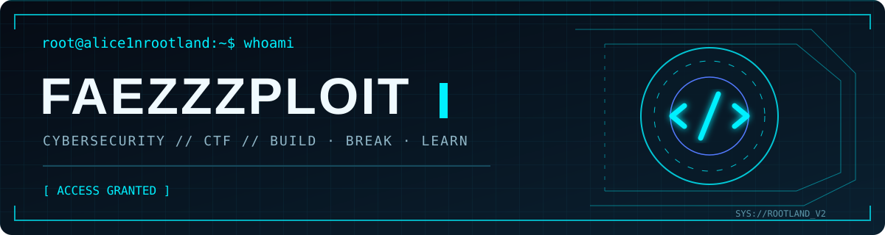

<code>root@alice1nrootland:~$ ./learn_build_break_repeat.sh</code>

> whoami
┌──(faez㉿rootland)-[~]
└─$ cat profile.txt

Name        : Faez / Faezzzploit
Location    : Malaysia
University  : Universiti Teknikal Malaysia Melaka (UTeM)
Community   : CyberOps UTeM
Role        : Vice President
Focus       : Offensive Security | CTF | Threat Intelligence
Status      : Always Learning
Cybersecurity student exploring how systems work, how vulnerabilities arise, and how to secure them. I enjoy CTF challenges, Boot2Root labs, vulnerability assessment, and building small security tools in authorized environments.
Break things in labs. Understand how they work. Learn how to defend them.

> cat current_operations.txt
Mission	Current focus
🎯 CTF / Boot2Root	Enumeration, privilege escalation, technical writeups
🛡️ Security Assessment	Nmap, Nessus, CVE research, reporting
🌐 Web Security	Application testing and security fundamentals
🐍 Build & Automate	Python, Bash, security experiments
🤝 CyberOps UTeM	Community activities and student collaboration

> ls -la ~/projects
<table>
<tr>
<td width="50%" valign="top">
<h3>⌁ Hacking Lab</h3>

CTF &amp; Boot2Root writeups, OSINT experiments, security scripts, and learning resources.

</td>
<td width="50%" valign="top">
<h3>⌁ Portfolio</h3>

Academic projects, development experiments, cybersecurity work, and creative builds.

</td>
</tr>
</table>Some projects and writeups stay private until they are ready for public release.
> ./toolbox --list

Security toolkit: Kali Linux · Nmap · Wireshark · Burp Suite · Nessus · Metasploit
> cat community.log
CyberOps UTeM — Vice President

Supporting student cybersecurity activities, technical learning, events, and collaboration.
> ./contributions --animate

<!-- This animation is generated by the included GitHub Actions workflow. -->

<b><code>&gt; cat learning_journey.md</code> — expand</b>
CTF: Linux/Windows enumeration, web challenges, privilege escalation, writeups.

Assessment: Service discovery, Nessus scans, CVE analysis, remediation reporting.

Development: Python scripts, Bash automation, hands-on security experiments.

I practice only in intentionally vulnerable or otherwise authorized environments.

<code>[ SYSTEM STATUS: ALWAYS LEARNING ]</code>

Build responsibly · Test with permission · Share what you learn.

<code>root@alice1nrootland:~$ exit</code>

